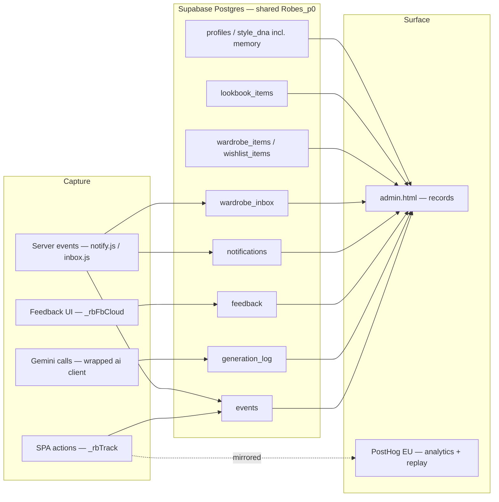

# Robes — Admin Panel Architecture

Internal admin surface for Robes (beta.byrobes.com now, byrobes.com after cutover): track what users do, review LLM output and feedback, browse wardrobes and lookbook outputs.

**Status: built and live on beta since 2026-07-21; extended through 2026-10.** This document is the reference for the system as it stands, reconciled against the code on 2026-10-24 (`public/admin.html`, `supabase/admin_capture_migration.sql`, `server.js`, `notify.js`, `inbox.js`, `public/js/posthog.js`). The original design doc's decisions all held; §12 lists what changed since it was written, and §13 lists the known gaps.

Stack unchanged: vanilla SPA on Railway, Supabase (Postgres + Auth + Edge Functions, one shared project `Robes_p0` for beta and production), Cloudinary, Gemini for styling, Anthropic for the wardrobe-context Edge Function, PostHog EU for analytics.

---

## 1. Problem (as originally framed)

Airtable covered the byrobes.com waitlist path, but beta writes to Supabase and nothing viewed it. Three goals were readable from existing tables; actions and the LLM trail were not captured at all.

| Goal | Source | Status now |
|------|--------|-----------|
| View wardrobe items | `wardrobe_items`, `wishlist_items` | Built |
| View lookbook outputs | `lookbook_items` (+ share cols) | Built, with a visual output viewer |
| View profile / Style DNA | `profiles` (+ DNA cols) | Built (summary is partly stale, see §13) |
| View feedback on outputs | `feedback` table | Built; Supabase is the source of truth from 2026-07-21. Airtable `Feedback` still receives a parallel post for continuity, not backfilled |
| Track user actions | `events` table + PostHog | Built |
| LLM prompt/output trail | `generation_log` | Built, every Gemini call, joined by `gen_id` |
| What she has told Robes | `profiles.style_dna.memory` | Built (added 2026-09-30) |
| Emails sent | `notifications` ledger | Built (added 2026-09-21) |
| Forwarded receipts | `wardrobe_inbox` | Built (added 2026-09-23) |

---

## 2. Architecture decisions

### ADR-1 — The record panel is a custom `admin.html` in the repo, not a low-code SaaS
Protected page in the existing app, admin-gated, reading Supabase directly with the admin's own JWT. Same shape as `dashboard.html` / `settings.html`. Keeps photos and Style DNA (face reads) inside owned infrastructure. No new vendor.
Flip condition: a non-technical teammate needs to browse records → a hosted GUI (Retool) earns its keep.

### ADR-2 — Record-browsing ships before analytics
Qualitative per-user review is where the value is at closed-beta N. Held.

### ADR-3 — Analytics is bought (PostHog), not built — **delivered 2026-09-16**
PostHog EU (project 275134) carries autocapture, session replay and funnels. The in-DB `events` / `generation_log` tables still own outcomes, tokens and cost. Details in §6.

---

## 3. System shape

---

## 4. Layer 1 — capture (migration 11, run on Robes_p0 2026-07-21)

`supabase/admin_capture_migration.sql`. Additive and idempotent. Requires migration 10 (references `wishlist_items`). Every capture write fails silently until it runs.

### 4.1 Admin flag + recursion-safe helper
`profiles.is_admin boolean not null default false` and `public.is_admin()` (security definer, reads the caller's own row — a plain `exists(...)` inside a policy on `profiles` would recurse). Granted to slatteryannie@gmail.com. Grant others with:
`update public.profiles set is_admin = true where id = '<auth-uid>';`

### 4.2 `events` — action log
Columns: `id, user_id, event_type, metadata jsonb, environment, created_at`. Own-insert + admin-read RLS. Indexes on user, env, type, created_at.

**Who writes it**
- **The dashboard**: `_rbTrack(type, meta)` in `dashboard-personalize.js`, via `_rbCapturePost`. It writes BOTH planes in one call — the `events` row and a PostHog `capture` (mirrored before the uid guard, so a missing JWT still reaches PostHog).
- **Onboarding / Settings**: `obTrack` / `snTrack` mirror the same two planes (supabase-js inserts default to `return=minimal`).
- **The server**, with the service key: `email_sent {kind, ref}` (`notify.js`, every sent mail) and `receipt_received {retailer, items, seen, inbox_id, order_ref}` (`inbox.js`, every held receipt). These land under the user's id whoever is signed in.

**Vocabulary.** The original twelve (`prompt_submitted`, `photo_attached`, `wardrobe_pick`, `look_generated`, `weekly_generated`, `travel_generated`, `day_restyled`, `piece_swapped`, `wardrobe_added`, `wishlist_added`, `share_created`, `feedback_given`) are still the backbone, except `weekly_generated`, which is dead since the weekly track was removed (ADR-001, 2026-08-08). The vocabulary has since grown to ~170 event types across looks, the diary, the deck, the look prompt, the add flow, home modules, onboarding and settings. Specifics always go in `metadata`. Notable ones the admin and the mail sequence read:
- `model_filed {by, gender}` and `robes_build_opened {door}` — read by `notify.js` to decide the `look_waiting` and `five` mails.
- `prompt_submitted {intent, scope, source, balance, dated}` — fired on every submit, including failures.
- `email_landed {path}` — a visit that came from a mail.

Keep new names in the `noun_verb` past-tense form and keep using `metadata` for detail rather than minting variants.

**Write rule (launch-day bug).** `events` and `feedback` are insert-only for ordinary users (SELECT is admin-only). Every client insert must send `Prefer: return=minimal`. `return=representation` makes PostgREST run `INSERT … RETURNING`, the returned row is checked against SELECT policies, and the insert fails 42501 for every non-admin.

### 4.3 `generation_log` — LLM call trail
Columns: `id, user_id, endpoint, model, tokens_used, latency_ms, status, prompt, response jsonb, detail jsonb, environment, created_at`. Admin-read only; written by the server with the service key.

**How it's captured** (`server.js`, top of file):
- `ai.models.generateContent` is wrapped ONCE at module load, only when `SUPABASE_SERVICE_ROLE_KEY` is set. There is one `GoogleGenAI` instance in the codebase, so every Gemini call — text and background image loops, every endpoint — is logged with no per-endpoint wiring.
- An `AsyncLocalStorage` middleware on `/api` carries `{endpoint, userId, genId, userPrompt}`. The background image IIFEs start inside the request handler, so the context survives into every staggered frame after the response is sent (verified with a repro script).
- `prompt` = the full system instruction + text parts (inline images are counted in `detail.input_images`, never stored). `response` = the parsed JSON for text models; `{has_image}` for the image model — never base64.
- `status`: `ok` | `partial` (image call returned no frame — the "2 of 3 images" case) | `timeout` | `error`.
- `environment` = `APP_ENV`, derived from `PUBLIC_URL` (`www.byrobes.com` → production, else beta). One constant per process.
- `/api/health` reports `generation_log: true|false`.

**`detail` keys in use**
- `gen_id` — the client mints `_rbGenId()` per generation submit and sends it as `genId`; the same id is stamped into the saved lookbook entry's data. This is what joins *her typed words → every LLM call → the artifact* without a schema change.
- `user_prompt` — her raw `prompt` / `brief` / `activity`, 400 chars.
- `input_images`, `error`.
- Composition rows (`stage: 'composition'`, written by an extra manual `glog()` on `/api/daily` and `/api/travel`): `owned_count`, `item_count` — the queryable owned-vs-new ratio. (The weekly per-day breakdown described in Tranche 2 went with the weekly track.)

**Payload size.** Briefs are large (DNA, brief, memory, icons, the numbered closet). Fine for now. Escape hatch when health queries slow: split `prompt`/`response` into a `generation_payloads` sibling joined by id. Add a retention policy (6–12 months) on payloads once volume is real.

### 4.4 `feedback` — output ratings
Columns: `id, user_id, lookbook_item_id bigint (soft reference, matches the client Date.now() id), track, rating int check (0,1), note, created_at`. Own-insert + admin-read.
- `rating`: 1 = thumbs up, 0 = thumbs down, null = no rating.
- Written by `_rbFbCloud(track, itemId, rating, note)` from every feedback path (the per-look hairline line on key pieces, the composer, the day console, the trip, moodboards). Tracks in use: `key-piece`, `daily`, `travel`, `moodboard`, `look`, `suggested` (`weekly` is legacy).
- Key-piece verdicts are per way: one row per look, with the way's title leading the note so a bare rating still says which look. The look prompt's verdicts also land here.
- Every verdict ALSO lands on the memory (§4.6), which is what the next generation reads.

### 4.5 Admin read across existing tables
Admin-read policies (existing own-row policies untouched) on `profiles`, `wardrobe_items`, `wishlist_items`, `lookbook_items`, `prompt_history` (migration 11), and since then `planned_days` (12), `tags` / `tag_pieces` / `tag_looks` (17, skipped with a notice if `is_admin()` is missing), `notifications` (22), `wardrobe_inbox` (23) and `looks` / `look_pieces` / `wears` (28, `supabase/looks_admin_read_migration.sql`, 2026-10-24 — **not yet run on Robes_p0**; until it runs an admin can read only her own looks, and the Looks section's empty state says so).

### 4.6 Other admin-visible stores added after migration 11
- **`profiles.style_dna.memory`** (2026-09-30, no migration): `{entries: [...], v: 1, read_at}`, newest first, capped at 60 — verdicts, swaps (`out/in/cat`), wears, struck brief lines, look-prompt asks. Written client-side by `_rbMemoryPush`. Every generation reads it through `styleDnaPromptBlock`.
- **`notifications`** (migration 22): the mail ledger, `unique(user_id, kind, ref)`, written only by the server.
- **`wardrobe_inbox`** (migration 23): one row per forwarded receipt, `status` held / filed / dismissed, `filed_to`, `filed_ids`. Inserted only by the service key.

### 4.7 `admin_user_overview()` RPC
Security definer, returns nothing unless `is_admin()`. One call gives email + last sign-in (from `auth.users`, which PostgREST can't join) plus per-user counts: wardrobe, wishlist, lookbook, feedback, last event, `total_count` for paging.
Signature: `(p_limit, p_offset, p_search, p_user, p_sort, p_dir)`. `p_sort` ∈ `created_at | name | email | onboarded | wardrobe | lookbook | feedback | last_event | last_sign_in`; limit clamped 1–200. The original 4-arg version must be dropped before recreating (two overloads make named-arg RPC calls ambiguous); the migration does this. If the deployed function predates the sort params (PGRST202), the panel falls back to sorting the visible page and says which SQL block to re-run.

---

## 5. Layer 2 — `admin.html` (as built)

Route `GET /admin` serves `public/admin.html`. `sbClient`, session check, then `profiles.is_admin`. No session, an error, or not admin → `location.replace('https://byrobes.com')`. Sign out does the same. Dense tables in the app's tokens, not the editorial styling. Not loaded with PostHog (our own browsing isn't product behaviour).

**Environment filter** in the top bar (`all | beta | production`, remembered in `localStorage rb_admin_env`): applies to the user detail's Activity and Generations and to Generation health.

**Screens** (hash-routed: `#users`, `#user/<uuid>`, `#health`, `#feedback`):

1. **Users** — the RPC, 50 a page, search on name/email, every column header sorts asc/desc server-side. Columns: Name, Email, Joined, Onboarded, Wardrobe, Lookbook, Feedback, Last action, Last sign-in.
2. **User detail** (`#user/<uuid>`), in this order:
   - Header: name, email, joined, onboarded or not, last sign-in.
   - **Profile · Style DNA**: season, undertone + contrast, body, style icons, budget, Instagram, which analyses exist.
   - **Feedback**: rating + note per artifact.
   - **Memory**: the `style_dna.memory` entries (kind · what · her words), with the last read date.
   - **Activity**: the event timeline (last 100, env-filtered).
   - **Emails**: kind · sent_at · ref from `notifications`.
   - **Receipts**: retailer · received · N pieces · N read from photographs · order ref · waiting / N filed to wardrobe or wishlist + when / nothing kept.
   - **Wardrobe** and **Wishlist**: thumbnail grids.
   - **Lookbook**: saved artifacts with type, date, shared status; a tile opens the output viewer.
   - **Looks** (2026-10-24, needs migration 28): her saved Look entities with suggested/draft rows counted apart — the frame (render → her photograph → the first piece's photo), piece count + proposals still to find, wears and last worn. A tile opens the **look viewer**: the frame, the note and tags, her pieces by slot and role with how each is worn (`styling`), the proposals still to find (and how many are wishlisted), the wear log and cost per wear when priced pieces exist.
   - **Generations**: grouped by `detail.gen_id` — when, endpoint, her prompt, one status chip per LLM call (`text ✓ · 2.1s`, `img partial`), and "Saved as" naming the artifact that carries that gen_id. A chip opens the full prompt / response / detail modal; the saved title opens the output viewer.
   - Long lists collapse: Activity and Memory show 8, Generations 10 (cap 100), with "Show all N" / "Show the latest N" at the card foot.
3. **Output viewer** (modal, 2026-09-15): renders a lookbook row visually per type — key piece (her attached photo + the three ways as frames with prose), daily look (occasion · date · city, stylist summary, pieces as tiles grouped by role, "✓ yours", brand · retailer · price, row notes), travel edit (destination · dates · vibe, hero frame, each look with its pins and pieces, the capsule with hers/packed counts), moodboard. Her prompt rides in from the gen_id; a public `/board/:shareId` link when shared; raw JSON in a disclosure. Image ladder mirrors the app: wardrobe photo, then the generated still at `image_index`.
4. **Generation health** (`#health`, last 7 days, 1000-row cap): stat tiles (calls, errors/timeouts, partial, users affected), By endpoint (calls / ok / partial / failed / median latency / tokens), Not-OK calls (click for the full prompt/response), then **Emails · last 7 days** (per-kind counts from `notifications`) and **Receipts · last 7 days** (across users, from `wardrobe_inbox`). Each section explains which migration is missing when its table is unavailable.
5. **Feedback** (`#feedback`): every user, newest first, paginated with `.range()`, names resolved from profiles.

Every list reads with `.range()` or a limit — nothing selects all.

---

## 6. Analytics — PostHog (delivered 2026-09-16)

- `public/js/posthog.js` on every page except `admin.html` and `specimen.html`. The project key is public by design (write-only ingestion) and sits in the file; blanking it is the kill switch.
- All app calls go through `window.__rbPH(fn)` (queues up to 40 until the library lands, drops silently if blocked). Never call `window.posthog` directly.
- Pageviews are fired by the loader on `pushState` / `replaceState` / `popstate` (`capture_pageview: false`), because the dashboard is one page that pushes real paths.
- Identity: the Supabase uid via `__rbPHUser(session, profile)` at the dashboard, onboarding and settings boots; `__rbPHReset()` on sign-out. `gender_identity` is not sent.
- `environment` is a super property, matching `events.environment`.
- `_rbTrack` mirrors the whole events vocabulary into PostHog, so funnels and the admin timeline speak the same names.
- **Session replay masks passwords only** (`maskAllInputs: false`, `maskInputOptions: {password: true}`, plus `ph-no-capture` on both password inputs because their Show toggle flips the type). Everything else she types, including her prompts, records as typed, and wardrobe photographs appear by URL. `/privacy` says so. There is no opt-out and no consent gate yet.

---

## 7. Security

- No service key in the browser. Admin reads ride the admin's JWT through `is_admin()` policies; only the users list uses the security-definer RPC.
- The service key lives only on Railway (`SUPABASE_SERVICE_ROLE_KEY`) and is used by `glog`, `notify.js`, `inbox.js` and account deletion.
- A future reporting connection (Metabase etc.) gets a dedicated read-only Postgres role through the pooler, never the service role.
- `generation_log` holds raw user input at length (full prompts, her typed words in `user_prompt`). Admin-read only, never exposed to the client SPA. If the database is ever shared more widely, gate this table hardest or move it behind an Edge Function.
- RLS is on for every capture table from day one (own-insert + admin-read; server-only tables have no client insert policy).

---

## 8. Cost

At beta scale the run cost is effectively zero: `admin.html` rides the Railway service, the capture tables add negligible load, PostHog is on the free tier (check limits before relying on it). The variable cost is `generation_log` storage as volume grows — the payload split + retention in §4.3 is the lever.

---

## 9. Environments (beta → byrobes.com)

Beta and production share one Supabase project, so the admin plane is environment-agnostic.
- At cutover (merge `beta` → `main`, point production at it) there is no database step: migration 11 and every later admin policy already exist. `admin.html` ships in the repo and serves from byrobes.com.
- Auth is shared, so testers are already production accounts and `is_admin` carries over.
- Mixed traffic is separated by the `environment` column (client: hostname `www.byrobes.com` / `byrobes.com` → production; server: `PUBLIC_URL`) and the panel's env filter. `notifications` and `wardrobe_inbox` are per user and carry no environment.
- Split into separate Supabase projects only if test volume distorts production metrics despite the filter, or for hard isolation. It costs two migration runs and no single-pane admin view.

---

## 10. Implementation order (all done)

1. Migration 11 + admin grant — done 2026-07-21.
2. The three writes (`_rbTrack`, the `glog` wrapper, `_rbFbCloud`) — done 2026-07-21.
3. `admin.html` users list + detail, then health + feedback feed — done 2026-07-21.
4. `gen_id` correlation + the Generations trail — done 2026-07-21.
5. Composition `owned_count` / `item_count` rows — done 2026-07-22.
6. Output viewer + collapsed long lists — done 2026-09-15.
7. PostHog — done 2026-09-16.
8. Emails (user detail + health) — done 2026-09-21. Receipts (user detail + health) — done 2026-09-23. Memory — done 2026-09-30.

---

## 11. Decisions locked

- Feedback rating: 1 up, 0 down, null none.
- Prompt capture: full prompt + response in `generation_log`; payload split is the escape hatch.
- Non-admin access redirects to `https://byrobes.com`.
- Supabase `feedback` is the source of truth from 2026-07-21; Airtable is not backfilled.
- `admin.html` carries no PostHog.

---

## 12. What changed since the original design doc

1. `admin_user_overview()` RPC added for the users list (the doc assumed plain table reads; `auth.users` and per-user counts need the RPC). Server-side sort params added the same day.
2. `gen_id` + `user_prompt` in `generation_log.detail`, and the Generations section that joins prompt → calls → artifact.
3. The `Prefer: return=minimal` rule for insert-only tables (launch-day fix).
4. Composition rows with `owned_count` / `item_count`.
5. Server-written events (`email_sent`, `receipt_received`) beside the client-written ones.
6. The events vocabulary grew from 12 to ~170 types; `weekly_generated` and the `/api/weekly` endpoints are gone (ADR-001).
7. Output viewer modal and collapsed Activity/Generations.
8. User detail gained Memory, Emails and Receipts; Generation health gained Emails and Receipts tables.
9. Admin-read policies extended to `planned_days`, the tag namespace, `notifications` and `wardrobe_inbox`.
10. PostHog delivered, with free-love replay masking documented in `/privacy`.

---

## 13. Known gaps (not built)

- **Run migration 28.** The Looks section and look viewer are built (2026-10-24) but read other users' looks only once `supabase/looks_admin_read_migration.sql` has run.
- **Look renders aren't linked to their look.** `/api/avatar/render` generations still show "—" under Saved as: the image call logs only `{has_image}` and `looks` carries no `gen_id`. Linking needs the render job to log the look id (or `render_key`) in `detail`.
- **Suggested and draft looks** show only once migration 25 has run; before then they live on her device.
- **The Profile · Style DNA summary reads retired fields.** It shows `budget` (retired 2026-10-07; the level now lives in `style_dna.investment` / `annual_spend`) and doesn't show the brief (`style_dna.brief`), style types, brands, the facts, the palette (`style_dna.palette`), `gender_identity`, the twin (`twin_url`) or notification prefs.
- **`planned_days` isn't on the user detail** even though the admin can read it — no view of her diary.
- **Users list has no environment column or filter**; a user who only used beta is indistinguishable from one on production until the cutover.
- **No payload split or retention** on `generation_log` yet (§4.3).
- **No PostHog opt-out or consent gate.**
- **`prompt_history`** (the Anthropic Edge Function) is admin-readable but not surfaced anywhere in the panel.
